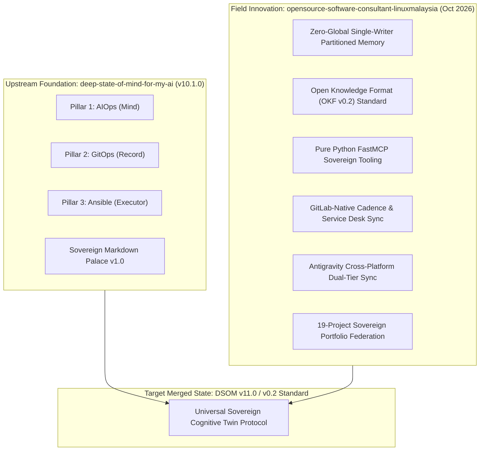
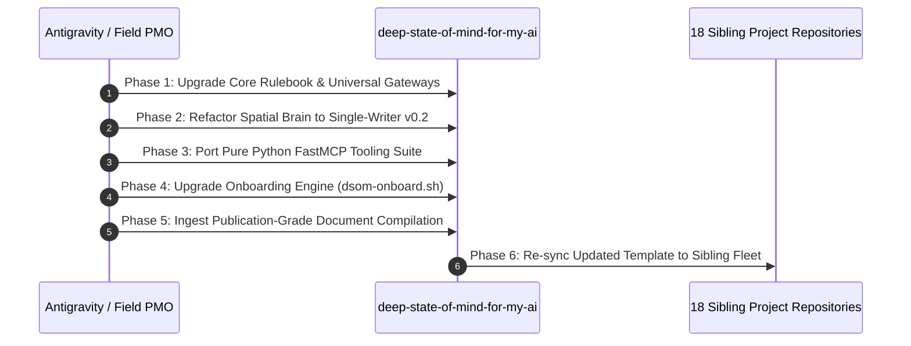

# Deep State of Mind (DSOM) Protocol Evolution & Upstream Harmonisation Specification

## Transmuting Operational Discoveries into the Foundational DSOM Architecture

---

| Metadata | Specification |
| :--- | :--- |
| **Principal Architect** | Harisfazillah Jamel (Handle: `LinuxMalaysia`), Senior ICT Consultant & Managing Director |
| **Target Upstream Repo** | `deep-state-of-mind-for-my-ai` (`/home/haris/kerja/deep-state-of-mind-for-my-ai`) |
| **Originating Testbed** | `opensource-software-consultant-linuxmalaysia` & Multi-Project Sovereign Matrix (19 Projects) |
| **Protocol Baseline** | DSOM v10.1.0-palace (April 2026) ➔ DSOM Protocol v0.2 / v11.0 (October 2026) |
| **Compilation Date** | 19 October 2026 |

---

## 1. Executive Summary & Purpose

The **Deep State of Mind (DSOM)** protocol originated in `deep-state-of-mind-for-my-ai` as a metacognitive governance framework enforcing three core pillars: **AIOps (Mind)**, **GitOps (Record)**, and **Ansible (Executor)** with the Sovereign Markdown Palace spatial index.

Over six months of continuous real-world execution across 19 production enterprise repositories (spanning critical infrastructure services, public service e-vetting, national identity platforms, higher education institutes, and cloud security environments), the protocol has advanced significantly. It has transitioned from a theoretical template into an active, multi-agent, cross-platform operational standard.

This document serves as the **formal upstream proposal and harmonisation specification**. It codifies all architectural upgrades, invariants, and battle-tested tooling created in the field, providing a clean merge blueprint for `deep-state-of-mind-for-my-ai`.



---

## 2. Core Protocol Evolutions (Field Breakthroughs)

### 2.1 Pillar 4: Zero-Global / Single-Writer Partitioned Spatial Memory
* **The Problem in v10.1.0:** Early DSOM relied on a monolithic `STATE.md` file in `.agents/brain/`. When autonomous agent pairs (e.g. Google Antigravity and OpenHands) collaborated simultaneously, concurrent writes caused Git merge conflicts and race conditions.
* **The v0.2 Breakthrough:**
  1. **Strict Partitioning:** Memory is divided into dedicated Single-Writer ledgers:
     - `state-antigravity.md`: Exclusively owned and written by Google Antigravity.
     - `state-openhand.md`: Exclusively owned and written by OpenHands.
     - `task.md` & `walkthrough.md`: Primary present and historical partitions.
     - `task-openhand.md` & `walkthrough-openhand.md`: Peer agent historical partitions.
  2. **Read-All / Write-Mine Invariant:** Both agents read all state files to maintain global awareness, but write *only* to their designated ledger. Antigravity acts as the local integrator.
  3. **Legacy `STATE.md` Deprecation:** Marked as an immutable historical archive.

### 2.2 Open Knowledge Format (OKF v0.2) Standard
* **The Problem:** AI agents frequently parsed Markdown files ambiguously, resulting in context confusion or encoding errors.
* **The v0.2 Standard:** Every Markdown file must strictly start at Line 1, Column 1 with `---` without UTF-8 BOM, followed by YAML frontmatter:
  ```yaml
  ---
  okf_version: "0.2"
  type: "explanation" # [sovereign_rulebook, ledger, reference, how-to, explanation, tutorial]
  title: "Document Title"
  timestamp: "2026-10-19T07:52:00+08:00"
  topics: ["keyword1", "keyword2", "keyword3"]
  description: "High-density technical synopsis."
  ---
  ```
* **Discovery Flow:** Before running commands or reading entire directories, agents execute a 5-step knowledge-first scan matching `topics:` and `description:` in frontmatter.

### 2.3 Pure Python FastMCP Tooling Mandate
* **The Problem:** Third-party MCP servers reliant on Node.js/npx introduced heavy node_modules trees, supply chain risks, and non-compliance with lightweight mobile-first environments (Samsung DeX + Termux).
* **The v0.2 Mandate:** All MCP servers must be authored in native Python using `mcp.server.fastmcp` and `httpx` (pinned to `mcp<2`):
  - `tools/mcp/gitlab_server.py`: GitLab issues, repositories, and MR management.
  - `tools/mcp/inferens_council.py`: Sovereign local LLM council triad deliberation.
  - `tools/mcp/qmd_server.py`: Hybrid BM25/Vector local documentation retrieval.

### 2.4 GitLab-Native Cadence & Triple-Ledger Synchronisation
* **Cadence Matrix:** Integration of GitLab scoped labels (`cadence::daily`, `cadence::weekly`, `domain::secops`, `workflow::triage`) directly with local Git and Gitea mirrors.
* **Triple-Ledger Sync:** All releases and operational milestones must remain identical across `README.md`, `CHANGELOG.md`, and `HISTORY.md`.
* **Anti-Heartbeat MR Invariance:** Autonomous agents are strictly forbidden from opening automated Merge Requests for routine 15-minute heartbeats or session memory updates. MRs are reserved for real deliverables.

### 2.5 Multi-Tier Genesis & Antigravity Zero-Amnesia Portability
* **The Problem:** Moving active AI pairing sessions between Windows 11 (Tier 1) and WSL2 Linux (Tier 2) caused context amnesia.
* **The v0.2 Solution:**
  1. `agy_session_sync.py`: Automated tool mirroring Protobuf (`.pb`), annotations (`.pbtxt`), SQLite databases (`.db`), and brain artifacts across OS boundaries.
  2. **Dual-Project Registration:** Minting stable project UUIDs and creating matching configuration JSONs on both Windows (`C:\Users\User\.gemini\config\projects\`) and WSL2 (`~/.gemini/config/projects/`).
  3. **Zero-Network Genesis:** Direct cloning via DrvFs (`/mnt/d/Users/...`) allowing instant multi-tier onboarding before remote cloud repositories are provisioned.

---

## 3. Concrete Merge Blueprint for `deep-state-of-mind-for-my-ai`

To adopt these breakthroughs into the upstream `deep-state-of-mind-for-my-ai` repository without disrupting existing Ansible playbooks or Palace indexes, execute the following phased merge plan:



### Phase 1: Core Rulebook & Gateway Alignment
1. **Adopt Dual `AGENTS.md` Pattern:**
   - Root `AGENTS.md`: Summary gateway redirecting to `.agents/AGENTS.md`.
   - `.agents/AGENTS.md`: Master constitutional laws (incorporating Laws 1–15 from the consultant testbed).
2. **Universal Gateway Matrix:**
   - Update `.cursorrules`, `CLAUDE.md`, and `.github/copilot-instructions.md` to redirect foreign AI assistants to `.agents/brain/` and enforce the Single-Writer invariant.

### Phase 2: Spatial Brain Refactoring (`.agents/brain/`)
1. Migrate folder from `.agent/` to `.agents/` for modern multi-agent standardisation.
2. Initialize Single-Writer ledgers:
   - Create `state-antigravity.md` and `state-openhand.md`.
   - Archive existing `STATE.md` with explicit notice: `> Superseded / Legacy Historical Archive`.
   - Structure `task.md`, `walkthrough.md`, `palace_registry.md`, and `active_context_manifest.md`.

### Phase 3: FastMCP Tooling Ingestion (`tools/mcp/`)
1. Copy the native FastMCP suite:
   - `tools/mcp/gitlab_server.py`
   - `tools/mcp/inferens_council.py`
   - `tools/mcp/qmd_server.py`
   - `tools/mcp/requirements.txt` (pinning `mcp<2`, `httpx`, `pydantic`)
   - `tools/mcp/README.md`
2. Add workspace-scoped configuration template: `.agents/mcp_config.json.example`.

### Phase 4: Modernising Onboarding Automation (`tools-and-automation/`)
1. Upgrade `dsom-onboard.sh` and `playbooks/dsom/onboard-dsom.yml`:
   - Incorporate OKF v0.2 frontmatter templating into all generated Markdown files.
   - Inject the Multi-Tier Genesis SOP and dual Antigravity project registration recipes.
   - Include the DrvFs zero-network clone procedure for Windows/WSL2 cross-platform teams.

### Phase 5: Publication-Grade Document Compilation
1. Ingest `tools/pdf/compile_doc.py` and `tools/pdf/white-theme.css`:
   - Replaces legacy GitBook/mdBook reliance with pure Pandoc + WeasyPrint publication-grade compilation.
   - Produces zero-toner-waste, executive-ready A4 PDFs and EPUBs from Markdown suites.

### Phase 6: Re-syncing Sibling Repository Fleet
1. Cascade updated DSOM baseline template to all 18 sibling repositories across the enterprise matrix using `dsom-onboard.sh`.

---

## 4. Multi-Project Synchronisation Checklist (Representative Sample)

Once `deep-state-of-mind-for-my-ai` is upgraded to DSOM Protocol v0.2 / v11.0, use this representative checklist to cascade improvements across the 18 sibling sovereign repositories:

| Target Repository (Anonymised Category) | Current Baseline | High-Priority Upgrade to Pull from DSOM Core |
| :--- | :--- | :--- |
| `sovereign-cloud-sanitisation` | DSOM v0.2 | Already aligned with latest v0.2; pull FastMCP suite for audit logs. |
| `public-warning-system-core` | DSOM v0.1 | Upgrade from monolithic `STATE.md` to Single-Writer `state-*.md`; add OKF v0.2 frontmatter. |
| `elastic-kibana-podman-fabric` | DSOM v0.2 | Already aligned with Quadlet v10.1; pull `compile_doc.py` for architecture reports. |
| `dr-elastic-kibana-podman-fabric` | DSOM v0.1 | Align memory brain with primary CSM repo; add dual AGENTS.md. |
| `logstash-kafka-podman-pipeline` | DSOM v0.1 | Implement OKF v0.2 frontmatter across playbooks and documentation. |
| `national-api-gateway` | DSOM v0.2 | Pull GitLab FastMCP server for automated API issue tracking. |
| `evetting-sovereign-portal` | DSOM v0.2 | Ensure DR route swing documentation adheres to Diátaxis reference standard. |
| `aws-3tier-cloud-infra` | DSOM v0.1 | Upgrade to DSOM v0.2; adopt OpenTelemetry vs Dynatrace decision records. |
| `academic-elastic-cluster` & `secops-soc-fabric` | DSOM v0.1 | Refactor legacy SOC playbooks to OKF v0.2; establish single-writer brain files. |

---

## 5. Conclusion & Action Items

The evolution of DSOM in `opensource-software-consultant-linuxmalaysia` has transformed the framework into an enterprise-ready, multi-agent cognitive operating model. By merging these specifications back into `deep-state-of-mind-for-my-ai`, the foundational repository will reclaim its role as the authoritative, cutting-edge source of truth for sovereign AI governance.

### Immediate Action Plan:
1. **Approve Specification:** Review this document as the master architectural directive.
2. **Execute Upstream PR/Commit:** Package Phase 1–6 improvements into a dedicated branch `feature/dsom-v11-field-harmonisation` inside `/home/haris/kerja/deep-state-of-mind-for-my-ai`.
3. **Run Validation Suite:** Execute OKF validation and Ansible onboarding dry-runs.
4. **Broadcast to Fleet:** Synchronise the 18 sibling repositories using the upgraded `dsom-onboard.sh` script.

---
*Deep State of Mind (DSOM) For My AI Protocol | Harisfazillah Jamel (LinuxMalaysia) | 2026-10-19*
*Standard: UK English | DBP-standard Bahasa Melayu Malaysia (Piawai) | GNU General Public License v3.0*
